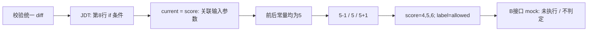

# 约 2 分钟演示：补丁 → 条件 → 关联 → 候选

这是**自建教学案例**，验证生成机制，不计入真实项目检出率。没有正确参考版本，也没有运行 oracle。

## 1. 展示补丁差异

`examples/teaching/int-threshold/{before,patch}/Threshold.java`：

```diff
 int current;
 current = score;
-if (current > 5) {
+if (current >= 5) {
     return 1;
 }
```

方法为 `teaching.Threshold#decide(int,java.lang.String)`。配置显式保留 `label="allowed"`，约束 min_length=1，预算 8 个候选。

## 2. 执行

```bash
bash modules/a/demo.sh
```

脚本输出新目录。打开 analysis.json：条件第 8 行、then 语句块范围第 8..10 行；JDT AST 定位条件，局部 `current=score` 将变化关联到 score，而不是把局部变量名当作输入参数。



## 3. 阅读真实生成产物

| 参数 | 候选 | 依据 |
|---|---|---|
| score | 4 | before 和 after 的 boundary=5, offset=-1 |
| score | 5 | before 和 after 的 boundary=5, offset=0 |
| score | 6 | before 和 after 的 boundary=5, offset=+1 |
| label | 全部保留 allowed | 允许配置，而非自动填 0 |

去重后是 3 个候选，每个保留两侧 provenance。若前后常量不同，正确性测试还验证了两侧边界的并集；若达到预算，events 会明确显示截断。

## 4. 展示协作接口和限制

b-mock.json 的 run_kind 是 mock，所有 value 都是 MOCK_ONLY，oracle 未评估。它仅证明 B 能按候选 ID、有序参数及类型读入；不说明补丁好坏。

Lang_51 仍作为历史原版成功基线。A 对其只做适用性检查：charAt/字符比较、null 检查及 switch 控制超出首版范围，输出 unsupported 和 0 候选。这里没有硬编码或重新发现 Fes，也没有重新运行已有基线。
## A 独立交付补充（2026-10-31）

演示入口仍为 `bash modules/a/demo.sh`；完整方法步骤见 REPORT.md，B 稳定读取见 B_HANDOFF.md。真实样例筛选与排除见 REAL_CASES.md，本轮未取得范围内真实正例；不得把上述教学候选或 mock 称为真实反例/检出率提升。独立内容验收入口为 `bash modules/a/handoff-check.sh`，从新缓存编译适配器并检查实际条件、参数、范围、值和规则。
